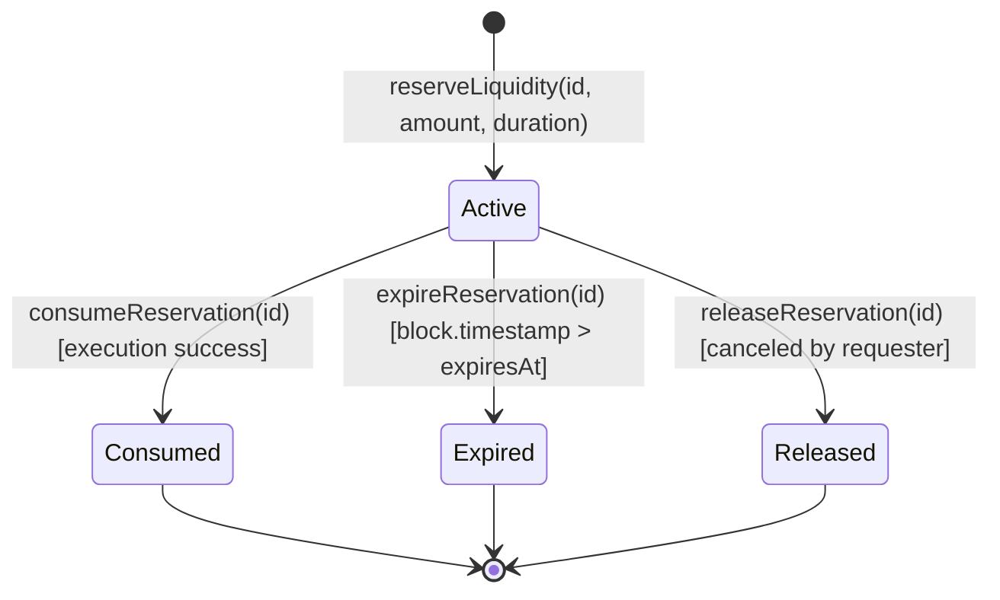

# Liquidity Reserve Floor, Route Reservation & Balance Reconciliation Specification

- **Workstream**: Oracle, Liquidity and Asset Risk
- **Repository**: `MDTechLabs/BridgeWise`
- **Specification Version**: `1.0.0`
- **Applicable Issues**: #1478, #1479, #1480
- **Status**: Normative / Production Hardened

---

## 1. Executive Summary & Objectives

Cross-chain liquidity pools and route execution systems face three critical asset safety vulnerabilities:

1. **Reserve Floor Depletion (#1478)**:
   Routes accepted without reserve floor constraints can drain a pool down to zero available liquidity. Draining a pool breaks liquidity for in-flight settlement, forces severe slippage on users, and prevents protocol solvency during market stress. A non-zero `reserveFloor` must be strictly enforced before route acceptance.

2. **Concurrent Route Reservation Oversubscription (#1479)**:
   In asynchronous cross-chain operations, a window exists between route quotation/acceptance and transaction execution. Concurrent users and relayers querying the same pool can simultaneously receive accepted routes whose cumulative volume exceeds available liquidity:
   $$\sum_{i} \text{amount}_i > \text{poolLiquidity} - \text{reserveFloor}$$
   When these transactions execute, the pool becomes insolvent or subsequent transactions revert unexpectedly. An atomic, race-free liquidity reservation mechanism is required to lock liquidity immediately upon route acceptance.

3. **Abandoned Reservation Accumulation & Balance Drift (#1480)**:
   Users who abandon transactions, disconnect wallets, or experience network drops leave reserved liquidity stranded. Without bounded time-to-live (TTL) and deterministic expiration, stranded reservations permanently reduce usable pool liquidity. In addition, physical token balances in vaults can drift from recorded balances due to rebase events or bridge fees. The protocol must allow permissionless expiration of abandoned reservations and administrative balance reconciliation.

---

## 2. Normative Invariants

| Invariant ID | Name | Description |
| :--- | :--- | :--- |
| `LR-1` | **Reserve Floor Enforcement** | At all times, the available unreserved liquidity minus requested route amount must be greater than or equal to the configured reserve floor: $\text{available} - \text{amount} \ge \text{reserveFloor}$. |
| `LR-2` | **Atomic Route Reservation** | Route acceptance must atomically lock requested liquidity in `routeReservedLiquidity`, preventing concurrent callers from oversubscribing pool capacity. |
| `LR-3` | **Strict Solvency Invariant** | Total pool physical balance must never fall below total reserved liquidity plus reserve floor: $\text{physicalBalance} \ge \text{totalReserved} + \text{reserveFloor}$. |
| `LR-4` | **Deterministic Expiration** | Any reservation not consumed before its `expiresAt` deadline may be permissionlessly expired, releasing reserved liquidity back to the available pool. |
| `LR-5` | **One-Time Consumption & Release** | A reservation can be consumed or released at most once. Double consumption, double release, or replay of existing reservation IDs must revert fail-closed. |
| `LR-6` | **Balance Reconciliation & Drift Tracking** | Administrative balance reconciliation compares physical vault balances with recorded state, logs drift, and fails if the physical balance cannot satisfy active reservations and floor. |

---

## 3. Reservation State Machine

### State Transitions
1. **Active**: Created with unique `reservationId`, `amount`, and `expiresAt = block.timestamp + duration`. Atomically increments `routeReservedLiquidity`.
2. **Consumed**: When user transfer or bridge swap executes, `routeReservedLiquidity` and `routeLiquidity` are both decremented by `amount`. Marked `completed = true`.
3. **Expired**: If `block.timestamp > expiresAt`, anyone calls `expireReservation(id)`. Decrements `routeReservedLiquidity`. Marked `released = true`.
4. **Released**: Early voluntary release by the reservation creator or admin. Decrements `routeReservedLiquidity`. Marked `released = true`.

---

## 4. Scope & System Architecture

### Affected Contracts and Components
- `contracts/bridge/route.sol` (`BridgeRoute`): Enforces reserve floors in route configuration and validation, manages atomic reservations, expiration, and balance reconciliation.
- `scripts/liquidity-reserve-reservation.ts`: Executable normative model for reserve floor enforcement, concurrent reservation locking, and balance reconciliation.
- `scripts/liquidity-reserve-reservation.spec.ts`: Unit, boundary, adversarial, and concurrency tests for the liquidity reservation model.

### Authorization Boundaries
- **DEFAULT_ADMIN_ROLE**: Configures routes, reserve floors, exposure caps, and performs balance reconciliation.
- **Requester / Relayer**: Acquires reservations, consumes them during transaction execution, or cancels early.
- **Permissionless Keepers**: Anyone may trigger `expireReservation` or `expireReservations` once TTL has passed.
- **Untrusted Callers**: Cannot bypass reserve floor checks, oversubscribe liquidity, or consume another party's unexpired reservation.

---

## 5. Versioned Chain Profiles

| Chain Identifier | Name | Min Reservation TTL | Max Reservation TTL | Default Reserve Floor Bps | Reorg Window | Parameter Source |
| :--- | :--- | :--- | :--- | :--- | :--- | :--- |
| `evm:1` | Ethereum Mainnet | 30s | 3600s | 1000 bps (10%) | 64 blocks | `liquidity-risk/1.0.0` |
| `evm:137` | Polygon PoS | 30s | 3600s | 1000 bps (10%) | 256 blocks | `liquidity-risk/1.0.0` |
| `evm:56` | BNB Smart Chain | 30s | 3600s | 1000 bps (10%) | 50 blocks | `liquidity-risk/1.0.0` |
| `evm:42161` | Arbitrum One | 15s | 1800s | 1000 bps (10%) | 10 blocks | `liquidity-risk/1.0.0` |
| `evm:10` | OP Mainnet | 15s | 1800s | 1000 bps (10%) | 10 blocks | `liquidity-risk/1.0.0` |
| `evm:8453` | Base | 15s | 1800s | 1000 bps (10%) | 20 blocks | `liquidity-risk/1.0.0` |
| `soroban:stellar` | Stellar Soroban | 10s | 1800s | 1000 bps (10%) | 1 ledger | `liquidity-risk/1.0.0` |

---

## 6. Security & Adversarial Threat Model

1. **Concurrent Race Condition Attacks**: Attackers send parallel requests to reserve more than 100% of available liquidity. The atomic storage update in `reserveLiquidity` ensures only requests that maintain $\text{available} \ge \text{amount} + \text{reserveFloor}$ succeed; subsequent concurrent calls revert with `LiquidityOversubscribed`.
2. **Reservation Griefing Attacks**: Attackers reserve small amounts across many IDs to tie up liquidity. Bounded duration TTL ($[\text{minDuration}, \text{maxDuration}]$) guarantees funds cannot be held indefinitely, and batch expiration (`expireReservations`) allows keepers to free griefed liquidity in single transactions.
3. **Replay & Double Spending**: Every reservation requires a non-zero, unique `bytes32 reservationId`. Re-using an ID reverts with `ReservationAlreadyExists`. Consuming an expired or already-completed reservation reverts.
